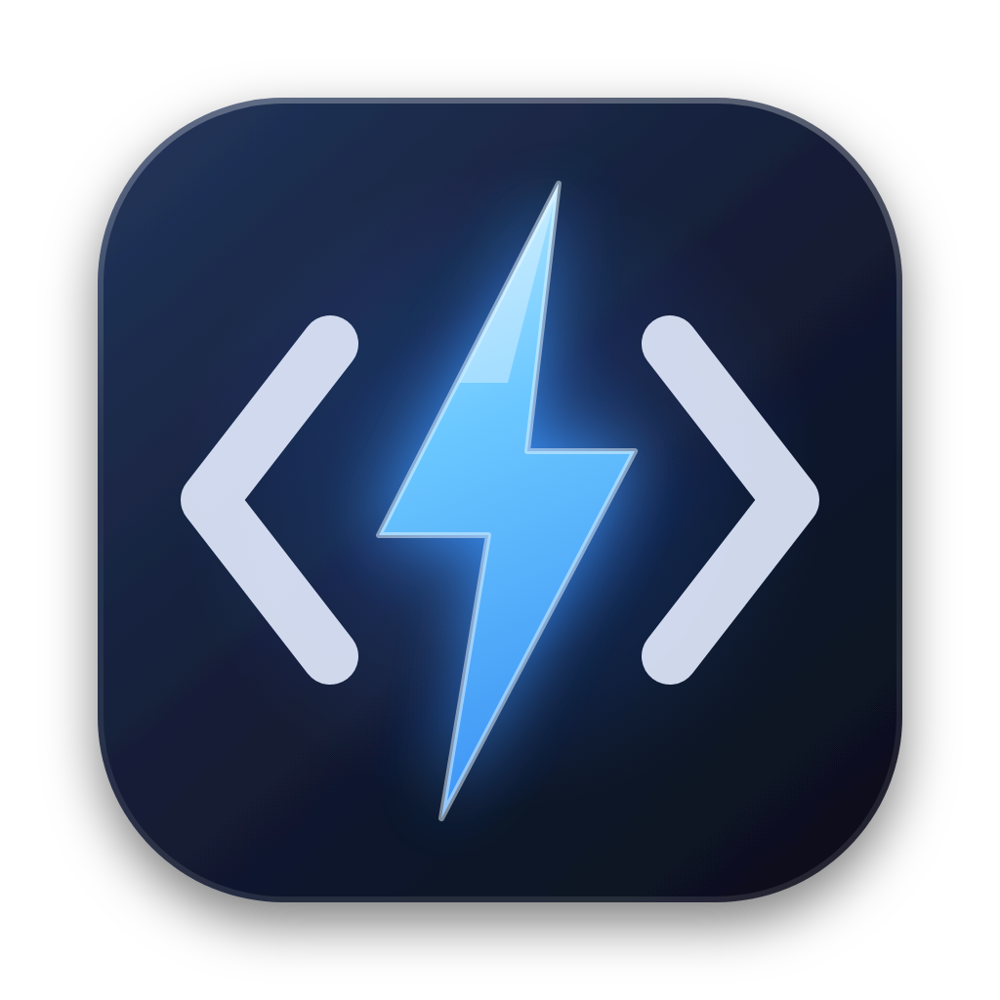
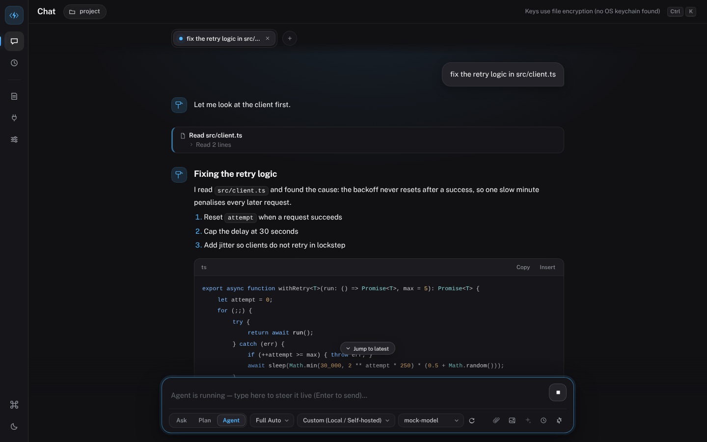
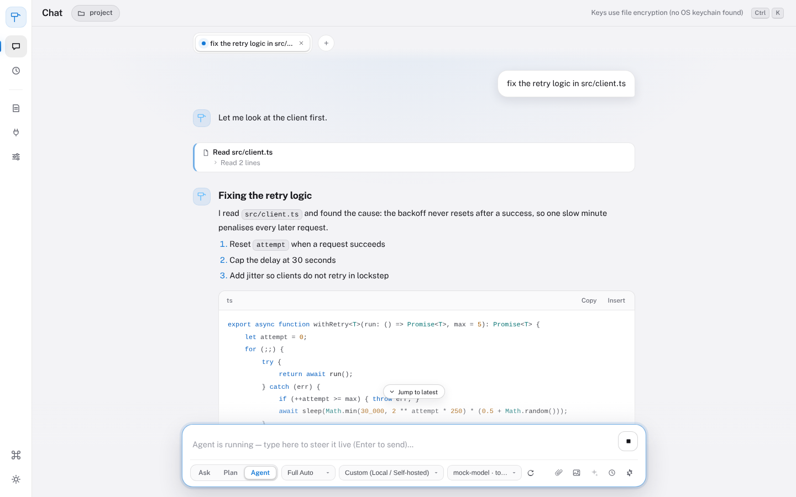
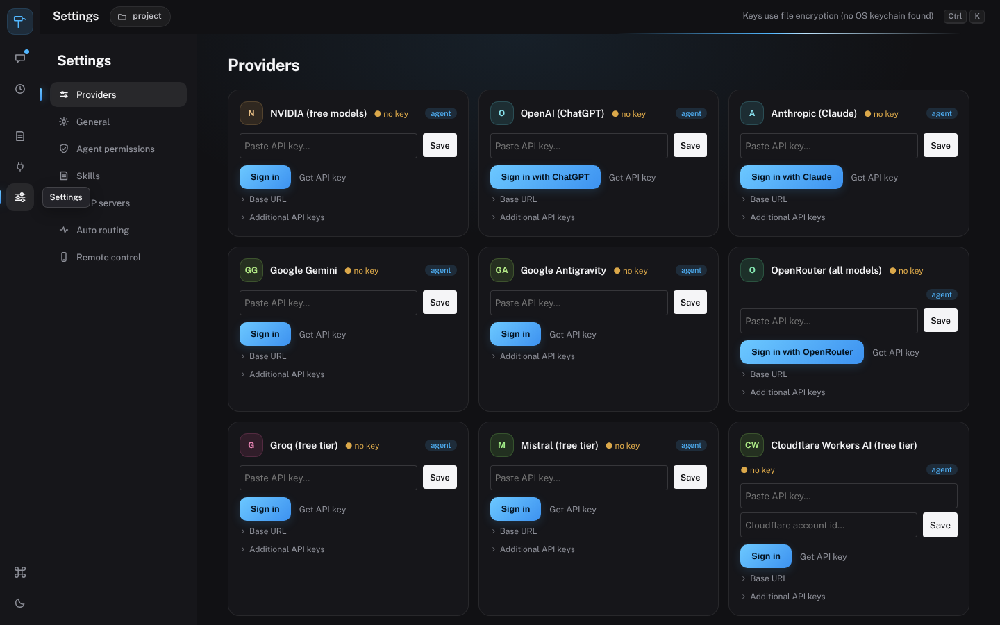
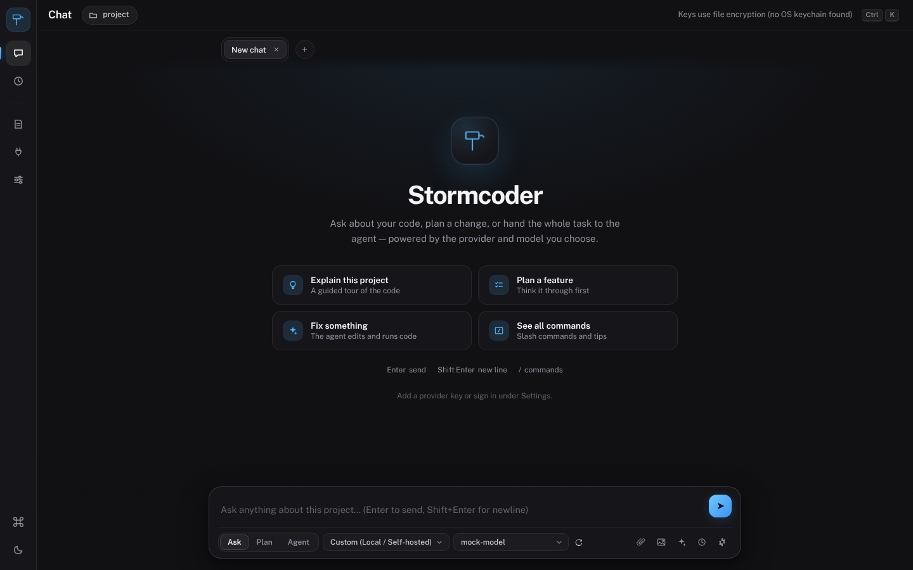
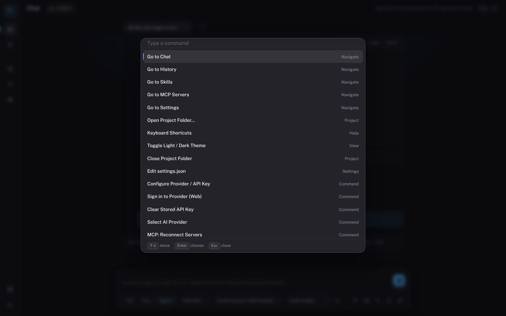
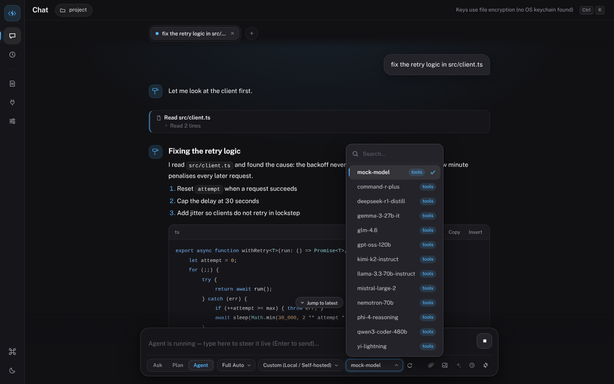
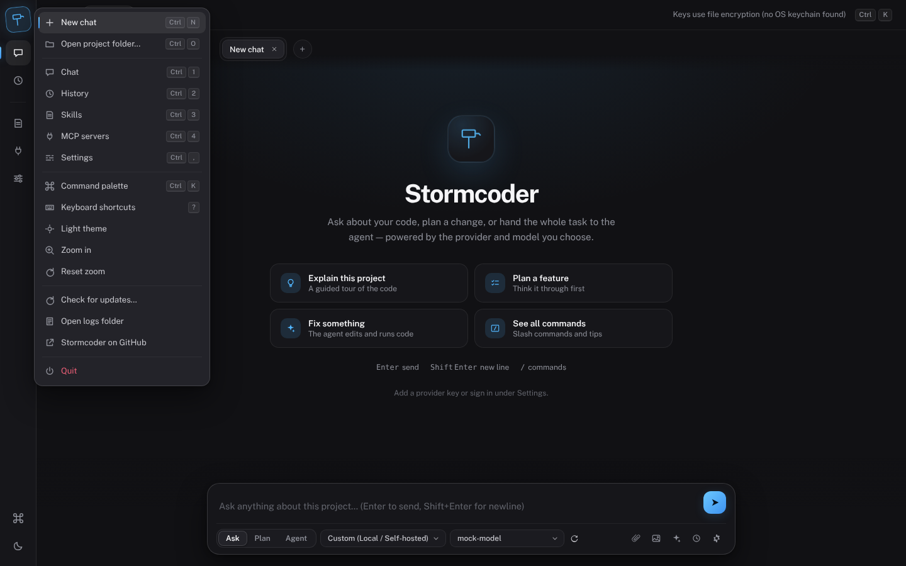

<p align="center"></p>

# Stormcoder

<p align="center"><strong>A desktop AI coding workspace that runs on your own keys and your own models.</strong><br>
Chat, plan, or hand a task to an agent that reads, edits and runs code in your project, with an Undo for every run.</p>

<p align="center">
  <a href="https://github.com/techgniouss/Stormcoder/releases/latest"></a>
  <a href="https://github.com/techgniouss/Stormcoder/stargazers"></a>
  
  <a href="LICENSE"></a>
</p>



It is a standalone Electron app: no VS Code underneath, no subscription, no account with us. Bring an API key, a ChatGPT or Claude sign-in, or a local model (Ollama, LM Studio, vLLM) and start working.

## Quick start

1. Download the installer for your OS from [Releases](https://github.com/techgniouss/Stormcoder/releases/latest).
2. Open a project folder and add a provider in **Settings > Providers** (or point *Custom (Local / Self-hosted)* at `http://localhost:11434` for Ollama).
3. Pick **Agent** mode and describe the change. Review the diff, approve, and use **Undo** if you change your mind.

## Why Stormcoder

| | Stormcoder | Typical AI editor |
| --- | --- | --- |
| Models | 15+ providers and any OpenAI-compatible endpoint, mixed per chat | One vendor, or a fixed list |
| Keys | Yours, kept in the OS keychain; no middleman server | Often routed through the vendor |
| Limits | Falls back to your next account when one hits its limit | Stops until the limit resets |
| Local models | First class (Ollama, LM Studio, vLLM) | Limited or paid |
| Safety | Protected paths, denied commands and workspace confinement enforced in code | Mostly prompt-based |
| Away from desk | Phone pairing with end-to-end encrypted approvals | Rare |
| Price | Free, MIT licensed | Subscription |

## What you get

- **Many providers, one place.** OpenAI, Anthropic, Google Gemini, OpenRouter, NVIDIA, Groq, Mistral, Cloudflare Workers AI, Kimi, Qwen, Z.AI, OpenCode Zen, GitHub Copilot, Grok, Kiro, and any OpenAI-compatible endpoint (Ollama, LM Studio, vLLM). Add multiple ChatGPT or Claude sign-ins, API keys, or supported provider logins. When an account reaches its limit, Stormcoder tries the next available credential and cools down the exhausted account. Claude offers automatic browser sign-in and a separate authorization-code option.
- **Ask, Plan and Agent modes.** The agent has file, search, shell and `fetch_url` tools, sub-agents, a todo list it must finish, and an Undo for every run. **Auto** mode routes planning, implementation and review to different models from the keys you hold.
- **Parallel chats.** Tabs stream at the same time. Type while a run is going to queue a message or steer the agent. History is kept and can be reopened.
- **Skills and rules.** Instruction packs you switch on per chat, plus always-on rules from `AGENTS.md`, `.stormcoder/rules.md` and similar files.
- **Memory.** Stormcoder remembers between chats. The agent saves short facts with `remember` (a build quirk, a convention, a decision), each run that changes files is journaled, and `recall` searches all of it, plus past chats, on demand. New chats start with your own notes, the project's saved facts and the last few runs, capped at about 1,700 tokens. Review, pin, edit, delete and add notes in Settings > Memory, or type `/memory`. Optionally the model suggests notes after a run for you to accept. Files live in `.stormcoder/` and are git-ignored by default; your personal notes live in the app's data folder. Switch it all off with `stormcoder.memory.enabled`.
- **Optional Claude Code engine.** Set `stormcoder.engine` to `claude-code` (Settings > Agent engine) to run the agent through the Claude Code harness with any model you pick. Your MCP servers and skills load into it; Auto routing, steering, `/compact` and Stormcoder's memory tools do not apply while it is on. The default is the built-in agent. See `docs/ENGINES.md`.
- **MCP servers.** Stdio and HTTP (Streamable HTTP and legacy SSE), per project or global. Project servers ask before they start.
- **Remote control.** Pair a phone through a relay (hosted on Cloudflare, or served from your machine through a tunnel) to send messages and answer approvals away from the desk. An optional Android app (`android/`) bundles the phone app. Messages are end-to-end encrypted between the phone and the desktop; the relay only routes sealed frames (see `docs/REMOTE-E2E.md`).
- **Polished to use.** Searchable model and provider menus, an app menu, a project switcher, right-click menus, a copy button on every message, styled tooltips, a shortcuts sheet (`?`), and dark and light themes.
- **Hard guardrails.** Protected paths, denied commands, workspace confinement and untrusted-folder write blocking are enforced in code, whatever the model says.

| Light theme | Settings |
| --- | --- |
|  |  |

| Welcome | Command palette |
| --- | --- |
|  |  |

| Model menu | App menu |
| --- | --- |
|  |  |

## Using it

Download an installer from the Releases page, open a project folder, and add a provider in Settings. Press `Ctrl+K` (`Cmd+K`) for the command palette. `Ctrl+1` to `Ctrl+4` jump between Chat, History, Skills and MCP servers, and `Ctrl+,` opens Settings.

Settings are in `settings.json` (palette: *Edit settings.json*). API keys are stored with your operating system's keychain; where there is none, they are encrypted in a local file and Stormcoder says so in the title bar.

In Settings > Providers, **Add key** and the account sign-in buttons retain existing credentials. The account list shows the active credential and lets you remove individual accounts. API keys and subscription sign-ins can share a fallback pool for the same provider; the most recently added credential is selected first. To add another browser account, choose that account on the provider's sign-in page (sign out there first if the browser reuses the previous login). Provider subscriptions and API access still have their own model permissions. See [provider accounts and fallback](docs/PROVIDER-ACCOUNTS.md).

**Local and self-hosted models.** Pick *Custom (Local / Self-hosted)* in Settings > Providers and enter the server's address, for example `http://localhost:11434` for Ollama or `http://localhost:1234` for LM Studio (`/v1` is added if you leave it off). No API key is needed unless your server asks for one. Press *Test connection*; the models the server lists appear in the model picker, and the *Model name* box covers servers that do not list any.

**Updates.** Stormcoder checks the GitHub releases shortly after it starts and every few hours, and downloads a newer version in the background. A "Restart to update" button then appears in the header; it also installs the next time you quit. Check by hand from the app menu (the mark at the top of the rail), the command palette, or Help > Check for Updates. A `.deb` install cannot update itself, so it shows a link to the release page instead.

## Develop

```bash
npm install
npm run build          # bundles the app into dist/
npx electron .         # run the desktop app
npm run dev:web        # same engine and UI in a browser, for quick UI work
npm test               # typecheck, unit tests, browser end-to-end, Electron smoke
npm run dist           # installers for the current OS into release/
```

Node 22 or newer. The end-to-end tests need Chromium (`npx playwright-core install chromium`) and, for the Electron smoke test, a display (`xvfb-run` on Linux CI).

## How it fits together

```
 shell page (shell/)            host (Electron main process)             engine (src/)
 rail, palette, prompts   <-->  Controller: folder, trust, requests <--> providers, agent loop,
 two frames: chat, settings     preload bridge, asset protocol           MCP, sessions, remote
        |                                  |                                   |
        +---- postMessage ---- ipc -------+---- `vscode` API slice (host/) ---+
```

The engine under `src/` was written against the VS Code extension API. Instead of forking it, `host/vscode.ts` implements the slice it uses (settings in JSON, encrypted secrets, workspace files, dialogs, webviews as frames) so the engine runs unchanged. Editor-only features (inline completions, code actions, the active text editor) are not part of this app. See [docs/ARCHITECTURE.md](docs/ARCHITECTURE.md).

## Design

The interface follows the app style from [taste-skill](https://github.com/Leonxlnx/taste-skill), pushed toward something warmer than its flat default: layered surfaces, an electric blue accent used for selection and the one primary action, soft depth where things float, and motion that confirms what you did (a sliding rail indicator, crossfading views, staggered entrances, a travelling run line). Dark and light themes share one token set in `shell/tokens.css`. The typeface is Public Sans (SIL OFL), bundled for offline use.

## Layout

| Path | What it is |
| --- | --- |
| `src/` | The chat engine: providers, agent, auto routing, MCP, sessions, remote |
| `host/` | The `vscode` API layer and the Electron-free `Controller` |
| `electron/` | Main process, preload bridge, menu, browser dev host |
| `shell/` | The desktop shell page and the theme applied to the chat frames |
| `media/` | The chat UI (transcript, composer, settings), unchanged from the extension |
| `openvs-relay/`, `relay-pwa/` | The phone relay (Cloudflare Worker) and its web app |
| `scripts/`, `test/` | Unit tests (`scripts/test-*.mjs`), end-to-end and Electron tests, build scripts |

## License

MIT. Public Sans is under the SIL Open Font License.
